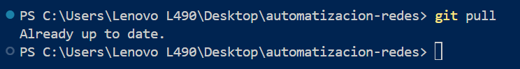
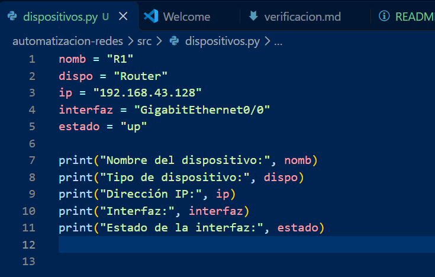
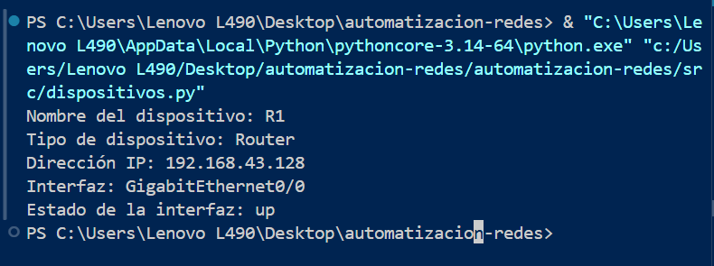
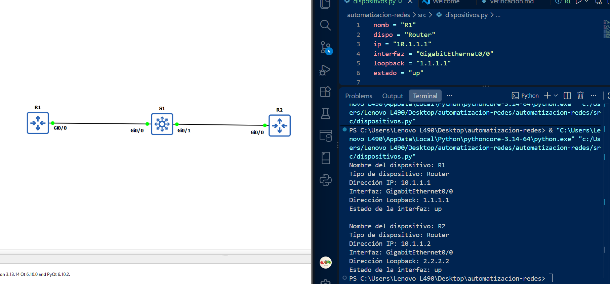
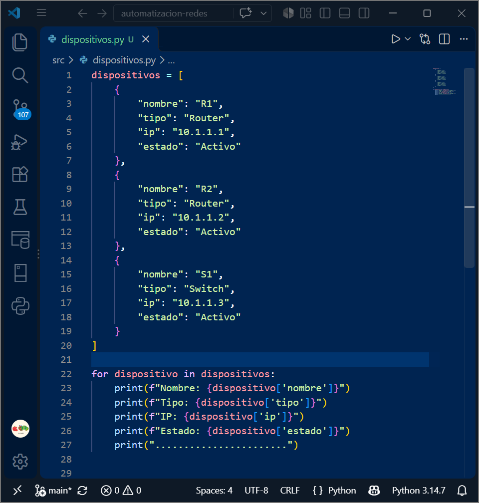
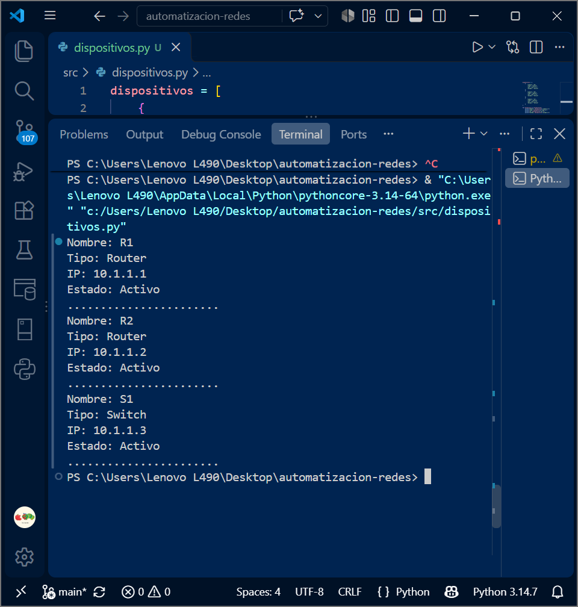

## 1. Propósito

En esta práctica se desarrolló un programa sencillo en Python (`src/dispositivos.py`) que representa y muestra información de los dispositivos de la red simulada en GNS3 de la Práctica 2 (routers y switch). La información se define dentro del programa, sin conexión real a los equipos. El objetivo fue entender cómo Python puede almacenar, organizar, modificar y mostrar datos de una infraestructura antes de usar bibliotecas de automatización.

## 2. Conceptos utilizados

| Concepto | Qué es | Cómo se usó en la práctica |
|---|---|---|
| **Variables** | Nombres que guardan un valor en memoria. | `nombre = "R1"`, `ip = "10.1.1.1"` para describir un dispositivo. |
| **Tipos de datos** | Clase de valor almacenado (`str`, `int`, `bool`, `list`, `dict`). | Nombre, tipo, IP, interfaz y estado son `str`; el dispositivo completo es `dict`; la infraestructura es `list`. |
| **`print()`** | Función que muestra información en pantalla. | `print("Nombre:", nombre)` para mostrar los datos de forma ordenada. |
| **Diccionarios** | Estructura de pares `clave: valor`. | Agrupan todos los datos de un equipo: `router1["ip"]`. |
| **Listas** | Colección ordenada de elementos. | `dispositivos = [R1, R2, S1]` representa toda la topología. |
| **Ciclo `for`** | Repite instrucciones por cada elemento de una colección. | Recorre la lista y muestra la información de cada dispositivo. |
| **Condicional `if`** | Ejecuta código según una condición. | Si `estado == "Activo"` imprime "disponible"; si no, "requiere atención". |
| **Funciones** | Bloque de código reutilizable con nombre. | `mostrar_dispositivo()` y `buscar_dispositivo()` evitan repetir código. |

## 3. Dispositivos representados

| Dispositivo | Tipo | Dirección IP | Estado | Función |
|---|---|---|---|---|
| R1 | Router | 10.1.1.1 | Activo | Enrutamiento |
| R2 | Router | 10.1.1.2 | Activo | Enrutamiento |
| S1 | Switch | 10.1.1.3 | Activo | Conectividad |

## 4. Evidencias

| # | Evidencia | Archivo |
|---|---|---|
| 1 | Estructura actual del repositorio |  |
| 2 | Codigo desarrollado |  |
| 3 | Ejecución del programa |  |
| 4 | Representación de dispositivos |  |
| 5 | Código con lista de dispositivos |  |
| 6 | Ejecución mostrando los dispositivos |  |

## 5. Problemas y soluciones

| Problema | Causa | Solución |
|---|---|---|
| `SyntaxError` al ejecutar | Falta una llave en el diccionario, lo que provoco el error. | Se verifico la linea que marcana error y se cerro correctamente la estructura. |
| `fatal: not a git repository` | La terminal estaba abierta en una carpeta distinta a la del repositorio. | Entrar a la carpeta del proyecto con `cd automatizacion-redes` o abrir esa carpeta en VS Code.|
| `NameError: name 'dispositivos' is not defined` | El nombre de la variable estaba mal escrito o se usó antes de definirla. | Corregir el nombre para que coincida exactamente y definir la variable antes de usarla. |
| `git push` rechazado | El repositorio remoto tenía cambios que no estaban en el local. | Ejecutar `git pull` y volver a hacer `git push`. |

## 6. Conclusión

En esta práctica usamos variables, tipos de datos, diccionarios, listas, ciclos `for`, condicionales `if` y funciones en Python, representando los dispositivos de la red de la Práctica 2 como diccionarios dentro de una lista, lo que nos permitió mostrar la información de forma organizada, para evaluar su estado. Se encontraron algunas dificultades como con git o usando variables de python, ya que con git se anidadon carpetas pero se eliminaron las que no eran y se dejo la que estaba conectada al github, y con las variables de python se vio detenidamente el error y se corrigio el error. 

Usando python se logra relacionar can la automatización de redes, ya que permite tratar la información de la infraestructura como datos que se pueden procesar, comparar y modificar sin hacerlo manualmente en cada equipo.

## Preguntas de analisis
1. ¿Por qué es útil representar la información de los dispositivos mediante un programa?
**A. Es util ya que permite la organizacion, almacenamiento y muestra la informacion de  los dispositivos de una red de manera rapida y bien organizada, facilitando la busqueda de equipos, la revision de sus estados y el procesamiento de los datos, lo que nos sirve al momento de automatizar las redes.**

2. ¿Qué ventaja ofrece utilizar un diccionario para representar un dispositivo? 
**A. ofrece agrupar a informacion de un dispositivo mediante claves y valor, facilitando el acceso y la modificacion de los datos de cada dispositivo de manera simple y rapida.**

3. ¿Qué ventaja ofrece utilizar una lista para representar varios dispositivos? 
**A. Nos permite el almacenamiento de diferentes dispositivos usando una sola estructura, logrando recorrerlos, mostrar su informacion y hacer operaciones sobre ellos sin escribir instrucciones individuales.**

4. ¿Qué tarea permite realizar el ciclo for? 
5. ¿Para qué se utilizó la estructura if? 
6. ¿Qué ventaja tiene utilizar una función? 
7. ¿Qué información de los dispositivos podría obtener automáticamente un programa en una 
etapa posterior? 
8. ¿Qué diferencia existe entre representar información de un dispositivo y obtener esa 
información directamente desde el dispositivo? 
9. ¿Cómo podría evolucionar este programa para convertirse en una herramienta de 
automatización de redes? 
10. ¿Qué relación existe entre esta práctica, la Práctica 2 y las siguientes prácticas del proyecto 
integrador?
